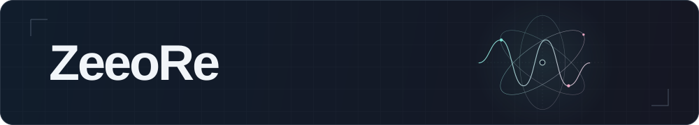
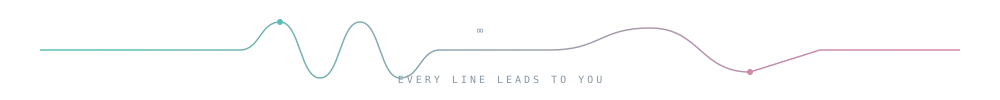

  

  <a href="https://github.com/2351548518?tab=repositories">Repositories</a>
  &nbsp; · &nbsp;
  <a href="https://space.bilibili.com/350688008">Bilibili</a>
  &nbsp; · &nbsp;
  <a href="https://github.com/2351548518?tab=stars">Stars</a>

 

> If I'm a set of points, then I will give you my dimension
>
> If I'm a circle, then I will give you my circumference
>
> If I'm a sine wave, then you can sit on all my tangents
>
> If I approach infinity, then you can be my limitations

  <strong>world.execute(me);</strong> 
  <a href="https://projectmili.com/miracle-milk-cn">Mili</a>

 

  

> 你是我万水千山的冒险, 要找的标记点
>
> 你是我分割人生的线, 又将它们相连
>
> 你是前世千次的回眸, 虔诚牵的手
>
> 你是其余所有的一切, 你是我的世界

  <strong>勾指起誓</strong> 
  <a href="https://www.bilibili.com/video/BV1Jb411U7u2/">洛天依 · ilem</a>

 

  

<!-- 歌词摘录保留自原 README；歌曲版权归原权利人所有。 -->
